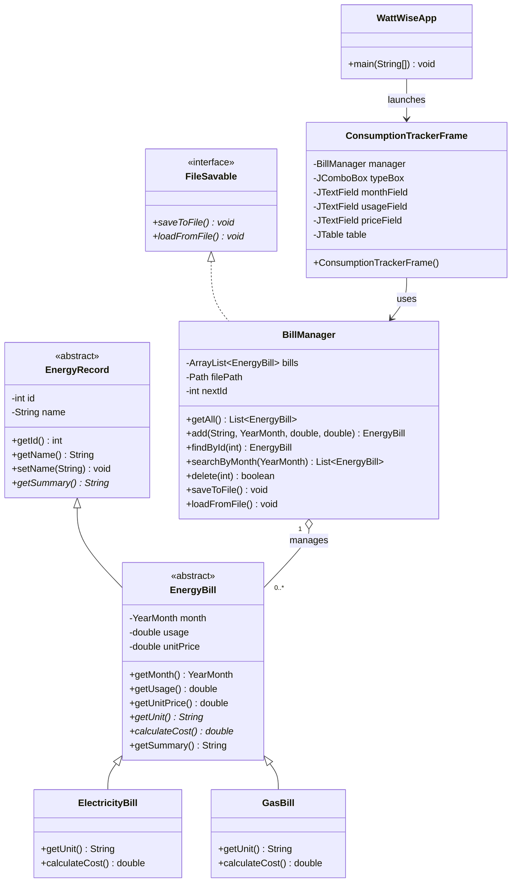

# WattWise - Consumption Tracker class diagram

Monthly electricity and gas bills (SDG 7: Home Energy Manager).

Cost rules (polymorphism: each child overrides `calculateCost()`):
- Electricity: `kWh * price per kWh + 3.50` (standing charge)
- Gas: `m3 * 11.0 kWh per m3 * price per kWh`
